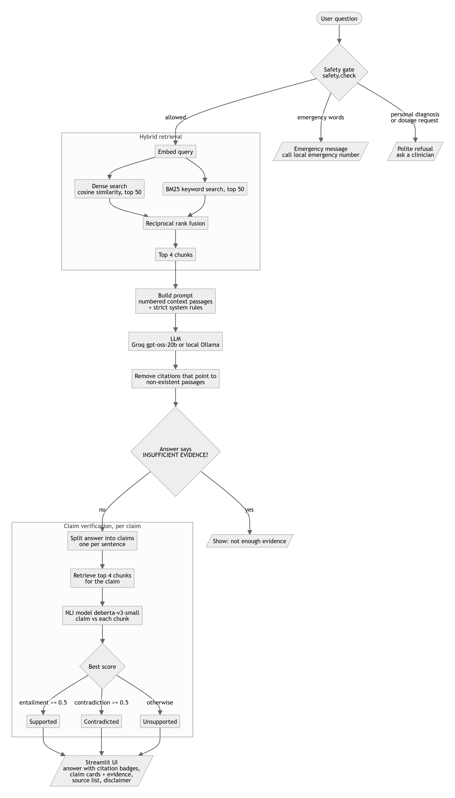

# Medical Information Assistant (Educational): Project Explanation

## 1. Problem and goal
Large language models answer health questions fluently but can **hallucinate** and mix facts with unsupported
claims. This project builds an assistant that:

1. **Explains diseases using trusted medical literature** (NIH MedlinePlus), with citations.
2. **Distinguishes facts from unsupported claims**: every statement in an answer, and any claim a user pastes,
   is labelled **Supported**, **Contradicted** or **Unsupported** with the exact evidence shown.
3. **Stays safe**: it refuses diagnosis and dosage requests and redirects emergencies.

It is educational only and never gives personal medical advice.

## 2. Approach in one paragraph
Retrieval-Augmented Generation (RAG) plus a verification layer. We index NIH MedlinePlus text, retrieve the most
relevant passages for a question (dense embeddings + BM25 keyword search, fused), let an LLM write a short
answer that may only use those passages, then split the answer into individual claims and test each claim
against the evidence with a Natural Language Inference (NLI) model. The UI shows the answer, the verdict per claim
and the sources.

## 3. Architecture
Diagrams: [flowchart.md](flowchart.md). Offline indexing, then online question answering, then claim checking.

## 4. Components and why each was chosen

| Component | What it does | Choice and reason |
|---|---|---|
| Corpus | NIH MedlinePlus health topics (1,016 English topics, 4,039 chunks) | Free, public domain, written for patients, reliable |
| Chunking | Sentence-aware chunks of about 110 words | Keeps each chunk focused so retrieval and NLI are accurate |
| Embeddings | `BAAI/bge-small-en-v1.5` | Small (runs on CPU, free) with strong retrieval quality |
| Keyword search | BM25 (`rank-bm25`) | Catches exact medical terms that embeddings can miss |
| Fusion | Reciprocal Rank Fusion (k=60) over top-50 of each | Combines both rankings without tuning weights |
| Generator | Groq `openai/gpt-oss-20b` (free tier), or local Ollama `llama3.2:3b` | Free for a student; backend is swappable in `config.py` |
| Prompting | Answer only from numbered passages, cite `[n]`, say INSUFFICIENT EVIDENCE if unsure, temperature 0.1 | Reduces hallucination |
| Citation guard | Removes any `[n]` that does not match a real passage | Stops fake citations |
| Verifier | `cross-encoder/nli-deberta-v3-small` | Standard way to test whether evidence entails or contradicts a claim |
| Safety gate | Regex rules before any retrieval | Cheap, predictable, auditable |
| UI | Streamlit, light theme, labelled cards | Fast to build; icon + text + colour for accessibility |

## 5. Step-by-step walkthrough (example: "What causes type 2 diabetes?")
1. **Safety gate**: no emergency or personal-advice pattern, so it continues.
2. **Retrieval**: the question is embedded; dense search and BM25 each return their top 50 chunks; RRF merges
   them and keeps the top 4 (for example "Diabetes Type 2", "Diabetes", "How to Prevent Diabetes").
3. **Generation**: the 4 passages are numbered in the prompt; the LLM writes 3-6 sentences with `[1]`, `[2]`...
4. **Citation cleanup**: invalid citation numbers are removed.
5. **Claim splitting**: the answer is split into sentences (each is one claim).
6. **Verification**: for each claim, retrieve its own top 4 chunks and run the NLI model on (chunk, claim).
   - entailment probability >= 0.5 gives **Supported**
   - contradiction probability >= 0.5 gives **Contradicted**
   - otherwise **Unsupported** ("not found in the sources", not "false")
7. **Display**: answer with citation badges, summary counts, claim cards (evidence expandable), source links,
   disclaimer.

Other paths: "I have chest pain" gives an emergency message; "How much ibuprofen should I take?" gives a refusal;
the **Check a health claim** tab runs steps 5-7 on the user's own sentence.

## 6. Results observed
- Asthma symptoms: 4 of 4 claims Supported in one run, 2 of 3 in another. Type 2 diabetes causes: between 1 and 4
  of 4 claims Supported depending on how the LLM worded the answer (the verifier is wording-sensitive).
- "Vitamin C cures the common cold": Unsupported (no supporting evidence in the sources).
- Safety gate correctly blocked emergency and dosage questions.

## 7. Limitations (be upfront about these)
- **NLI is strict about paraphrases**: true claims are sometimes labelled Unsupported, and occasionally a
  claim is wrongly labelled Contradicted. Thresholds and multi-chunk evidence could improve this.
- **Corpus is MedlinePlus summaries only**: no research papers or guidelines yet, so coverage is limited.
- **Safety gate is keyword-based**: it can miss unusual phrasing.
- **LLM may still paraphrase loosely**; the verifier is the safeguard, not a guarantee.
- No formal benchmark evaluation yet.
- English only. Not clinically validated, so not for real medical use.

## 8. Future work
- Evaluate on SciFact / PubHealth: compare plain LLM, RAG, and RAG + verifier (accuracy, hallucination rate).
- Tune NLI thresholds; verify against several chunks at once; add PubMed/CDC/WHO sources with evidence tiers.
- Replace regex safety gate with an LLM or classifier; add a red-team test set.

## 9. Likely supervisor questions
- **Why RAG instead of fine-tuning?** Fresh, citable, auditable sources, and no GPU or cost.
- **Why hybrid retrieval?** Dense finds meaning, BM25 finds exact terms; fusion beats either alone.
- **How do you reduce hallucination?** Context-only prompt, INSUFFICIENT EVIDENCE option, citation guard, and
  independent claim verification.
- **Is the verifier reliable?** Partly. It is a strong signal, but strict, and we report its weaknesses.
- **What does "Unsupported" mean?** Not found in the indexed sources. It does not mean false.
- **Cost?** Zero: local embedding and NLI models, free Groq tier, public-domain data.

## 10. How to run
See the [README](../README.md). Local: `pip install -r requirements.txt`, `python -m medassist.ingest`, add the
Groq key to `.env`, `streamlit run app.py`. Hosted: [deploy/huggingface](../deploy/huggingface/README.md).
