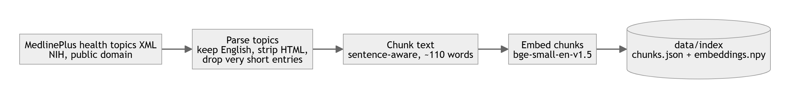
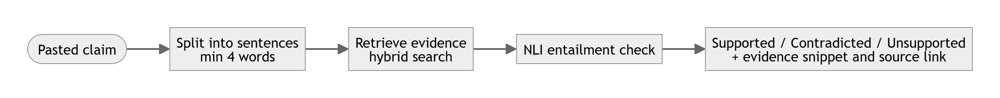

# System flowchart

PNG versions are shown below; SVG copies (zoomable) are in `docs/diagrams/`.

## 1. Offline: building the knowledge base (`python -m medassist.ingest`)

## 2. Online: answering a question (tab "Ask about a condition")

## 3. Online: checking a claim (tab "Check a health claim")

## Module map

| Step | File |
|---|---|
| Download, parse, chunk, embed | `medassist/ingest.py` |
| Hybrid retrieval (dense + BM25 + RRF) | `medassist/retriever.py` |
| Safety gate and disclaimer | `medassist/safety.py` |
| LLM call (Groq or Ollama) | `medassist/llm.py` |
| Orchestration, citation cleanup | `medassist/pipeline.py` |
| Claim splitting and NLI verdicts | `medassist/verify.py` |
| User interface | `app.py` |
